# The Lab — Database Overhaul Design Document (`docs/db-design.md`)

## 1. Executive Summary & Verification of Findings

An in-depth code audit of `supabase/migrations/00001`–`00016`, `seed.sql`, `seed_trainees.sql`, `lib/`, `middleware.ts`, `app/`, and `components/` was conducted. All 12 findings reported in the overhaul specification were audited against active code.

| # | Finding Description | Status | Verification Evidence in Current Codebase |
|---|---|:---:|---|
| 1 | `handle_new_auth_user` reads role from `raw_user_meta_data` (client-controlled) -> arbitrary admin signup | **TRUE** | `00002_profiles.sql:36` and `00014_fix_signup_triggers.sql:20`: `coalesce((new.raw_user_meta_data->>'role')::user_role, 'trainee')`. In `app/(auth)/signup/page.tsx:47`, client passes `role` in `options.data`. Anyone can pass `role: 'admin'` directly via Supabase Auth API. |
| 2 | `profiles_update_own_basic` does not restrict columns -> user can self-elevate to admin | **TRUE** | `00012_rls_policies.sql:58-60`: `create policy profiles_update_own_basic on profiles for update using (id = auth.uid()) with check (id = auth.uid())`. Without column-level REVOKE or trigger guard, any user can update `role = 'admin'` on their profile. |
| 3 | Views `v_*` without `security_invoker = true` bypass RLS and leak data | **TRUE** | `00006_plans_and_sessions.sql:55` and `00013_monitoring_views.sql:11-78`: Views created without `security_invoker = true`. In PostgreSQL 15+, default is `security_invoker = false`, meaning views run with owner privileges, bypassing underlying table RLS. |
| 4 | `quiz_attempts`: trainee can insert arbitrary score/passed -> self-pass | **TRUE** | `00012_rls_policies.sql:220`: `with check (... or trainee_id = current_teacher_id())`. Trainee can insert `{ score: 100, passed: true }`. Furthermore, `quiz_question_options` policy `00012:84` allows trainees to read `is_correct`. |
| 5 | Trainer can write plans/sessions/evidence for ANY trainee | **TRUE** | `00012_rls_policies.sql:146, 158, 170, 204, 230, 242`: All `with check` clauses only check `trainer_id = current_trainer_id()`. None check `is_my_trainee(trainee_id)`. |
| 6 | `recalculate_material_progress` has logic flaws, ignores `ca.material_id`, resets `completed_at`, lacks delete/config triggers, exposed via RPC | **TRUE** | `00011_progress_calculation.sql:85-115`: Filters `score >= min_score` before ordering by date (finds old pass even if latest failed). Assessment ignores `material_id` and checks only 1 competency instead of all. `completed_at` reset to `now()` every run. Triggers only on `INSERT`/`UPDATE`, missing `DELETE` and config changes. Function exposed to `/rpc`. |
| 7 | Helper RLS in `00016` became `VOLATILE plpgsql` (not `STABLE`), causing per-row re-evaluation | **TRUE** | `00016_fix_rls_regression.sql:11-64`: Defined as `plpgsql security definer` without `STABLE`. Evaluated for every single candidate row. Migrations 00015 and 00016 cancelled each other out with worse performance. |
| 8 | `seed_trainees.sql` fails on invalid UUID syntax and missing `auth.identities` | **TRUE** | `seed_trainees.sql:30, 47, 64`: Inserts `'TRN-SALWA'` into UUID column `teachers.id`. Inserts into `auth.users` without corresponding `auth.identities`, breaking GoTrue password logins. |
| 9 | Inconsistent `ON DELETE` (cascades audit records on trainer delete; restricts others) | **TRUE** | `00007_observations.sql:8` and `00008_assessments_and_quiz.sql:12` have `trainer_id ... on delete cascade`, whereas `00009_verification_and_followup.sql:9` and `00008:67` use default `RESTRICT`. |
| 10 | "Immutable" tables are only comments; admin can still update/delete | **TRUE** | `00012_rls_policies.sql:206-209`: Policies `assessments_admin_modify` and `assessments_admin_delete` exist. No database rule or trigger stops updates/deletes. |
| 11 | Naming inconsistencies (`teachers` vs `trainees`, uppercase vs lowercase enums, text check vs enum) | **TRUE** | `teachers` used for trainees; `user_role` is lowercase (`admin`, `trainer`, `supervisor`, `trainee`) while all other enums are UPPERCASE (`ACTIVE`, `PLANNED`, `SUBMITTED`, etc.); `teachers.status` is text check, not enum. |
| 12 | Repository hygiene: `temp.txt`, obsolete `README.md`, non-idempotent `seed.sql`, `SELECT *` in views | **TRUE** | `temp.txt` in project root with debug code; `README.md` documents old 00001-00013 and invalid admin setup; `seed.sql` throws error on second run due to duplicate keys; views use `SELECT *`. |

---

## 2. Naming & Database Conventions

### 2.1 Table & Column Naming
- All table names: plural snake_case (`trainees`, `trainers`, `training_plans`, etc.).
- Primary keys: `id uuid primary key default gen_random_uuid()`.
- Foreign keys: `<singular_entity>_id` (e.g. `trainee_id`, `trainer_id`, `material_id`, `profile_id`).
- Timestamps: Every mutable table includes `created_at timestamptz not null default now()` and `updated_at timestamptz not null default now()`, backed by trigger `trg_<table_name>_set_updated_at`. Append-only tables include `created_at timestamptz not null default now()` (or `attempted_at`).
- Indices: `idx_<table_name>_<column_name>`. Redundant indices covered by unique constraints are omitted.
- Policies: `<table_name>_<action>_<target_role>` (e.g. `observations_select_authenticated`, `observations_trainer_insert`, `trainees_select_staff`).
- Views: `v_<noun_phrase>` with `security_invoker = true` and explicit column list.

### 2.2 Standardized Enums (Lowercase snake_case)
All enums in the system are defined in lowercase:
- `user_role`: `'admin'`, `'trainer'`, `'supervisor'`, `'trainee'`
- `trainee_status`: `'active'`, `'inactive'`, `'graduated'`
- `requirement_type`: `'observation'`, `'competency_assessment'`, `'quiz'`
- `material_status`: `'not_started'`, `'in_progress'`, `'completed'`, `'verified'`, `'needs_review'`
- `assignment_status`: `'active'`, `'ended'`, `'transferred'`
- `session_status`: `'planned'`, `'completed'`, `'rescheduled'`, `'cancelled'`, `'missed'` (the redundant `'scheduled'` is eliminated; all scheduled training is `'planned'`).
- `delay_reason`: `'trainee_unavailable'`, `'trainer_unavailable'`, `'schedule_changed'`, `'material_issue'`, `'operational_issue'`, `'other'`
- `observation_status`: `'draft'`, `'submitted'`
- `verification_status`: `'verified'`, `'needs_review'`
- `followup_status`: `'open'`, `'in_progress'`, `'completed'`, `'cancelled'`
- `followup_trigger`: `'failed_assessment'`, `'needs_improvement'`, `'low_observation_score'`, `'missed_training'`, `'reassessment_required'`, `'other'`
- `progression_requirement_type`: `'required_materials_completed'`, `'min_competency_score'`, `'min_assessment_score'`, `'final_assessment_required'`, `'verification_required'`

---

## 3. Schema Architecture & Table Definitions

### 3.1 Migration File Breakdown
The new clean baseline will be organized in 11 modular migrations under `supabase/migrations/`:
1. `00001_types_and_helpers.sql`: Extensions (`pgcrypto`), all enums, `set_updated_at()` function.
2. `00002_identity_and_profiles.sql`: `profiles` table, `handle_new_auth_user()` trigger, `admin_set_user_role()` function.
3. `00003_hierarchy.sql`: `levels`, `training_tracks`, `training_units`, `training_materials`, `material_requirements`, `competencies`, `material_competencies`.
4. `00004_people_and_assignments.sql`: `trainers`, `trainees` (replaces `teachers`), `trainer_trainee_assignments`.
5. `00005_planning_and_sessions.sql`: `training_plans`, `training_sessions` (with plan consistency trigger).
6. `00006_evidence.sql`: `observations`, `observation_scores`, `competency_assessments`, `verification_records`, `trainer_followups` (with immutability triggers).
7. `00007_quizzes.sql`: `quizzes`, `quiz_questions`, `quiz_question_options`, `quiz_attempts` (with immutability trigger).
8. `00008_progress.sql`: `trainee_material_progress`, `recalculate_material_progress()` function, all evidence & config triggers.
9. `00009_progression.sql`: `progression_rules`, `progression_requirements`.
10. `00010_rls_and_grants.sql`: Schema-wide grants, RLS helper functions (`current_role_name`, `current_trainer_id`, `current_trainee_id`, `is_my_trainee`), and comprehensive policies.
11. `00011_monitoring_views.sql`: Consolidated monitoring views with `security_invoker = true`.

### 3.2 Table Specifications

#### A. Identity & Profiles
- **`profiles`**
  - `id uuid primary key references auth.users(id) on delete cascade`
  - `email text not null unique`
  - `full_name text not null`
  - `role user_role not null default 'trainee'`
  - `phone text`
  - `is_active boolean not null default true`
  - `created_at timestamptz not null default now()`
  - `updated_at timestamptz not null default now()`
  - *Permissions*: `REVOKE ALL ON profiles FROM anon, authenticated; GRANT SELECT ON profiles TO authenticated; GRANT UPDATE (full_name, phone) ON profiles TO authenticated;`

#### B. People & Assignments
- **`trainers`**
  - `id uuid primary key default gen_random_uuid()`
  - `profile_id uuid not null unique references profiles(id) on delete cascade`
  - `employee_code text unique`
  - `bio text`
  - `is_active boolean not null default true`
  - `created_at timestamptz not null default now()`
  - `updated_at timestamptz not null default now()`

- **`trainees`** *(Renamed from `teachers`)*
  - `id uuid primary key default gen_random_uuid()`
  - `profile_id uuid unique references profiles(id) on delete cascade`
  - `employee_code text unique`
  - `branch text`
  - `current_level_id uuid references levels(id) on delete restrict`
  - `join_date date`
  - `status trainee_status not null default 'active'`
  - `notes text`
  - `created_at timestamptz not null default now()`
  - `updated_at timestamptz not null default now()`

- **`trainer_trainee_assignments`**
  - `id uuid primary key default gen_random_uuid()`
  - `trainer_id uuid not null references trainers(id) on delete restrict`
  - `trainee_id uuid not null references trainees(id) on delete restrict`
  - `start_date date not null default current_date`
  - `end_date date`
  - `status assignment_status not null default 'active'`
  - `notes text`
  - `created_at timestamptz not null default now()`
  - `updated_at timestamptz not null default now()`
  - *Constraints*: `check (end_date is null or end_date >= start_date)`
  - *Unique Index*: `create unique index uq_assignments_active_trainee on trainer_trainee_assignments(trainee_id) where (status = 'active');`

#### C. Training Structure & Hierarchy
- **`levels`**: `id uuid pk`, `name text unique`, `code text unique`, `sequence_order int not null`, `description text`, `is_active boolean default true`, `created_at`, `updated_at`.
- **`training_tracks`**: `id uuid pk`, `level_id uuid not null references levels(id) on delete cascade`, `name text not null`, `code text not null`, `sequence_order int not null`, `description text`, `is_active boolean default true`, `created_at`, `updated_at`, `unique (level_id, code)`.
- **`training_units`**: `id uuid pk`, `track_id uuid not null references training_tracks(id) on delete cascade`, `name text not null`, `code text not null`, `sequence_order int not null`, `description text`, `is_active boolean default true`, `created_at`, `updated_at`, `unique (track_id, code)`.
- **`training_materials`**: `id uuid pk`, `unit_id uuid not null references training_units(id) on delete cascade`, `title text not null`, `description text`, `sequence_order int not null`, `is_active boolean default true`, `created_at`, `updated_at`.
- **`material_requirements`**: `id uuid pk`, `material_id uuid not null references training_materials(id) on delete cascade`, `requirement_type requirement_type not null`, `is_mandatory boolean not null default true`, `min_score numeric(5,2) check (min_score is null or (min_score >= 0 and min_score <= 100))`, `notes text`, `created_at`, `unique (material_id, requirement_type)`.
- **`competencies`**: `id uuid pk`, `name text not null unique`, `description text`, `category text`, `expected_level text`, `is_active boolean default true`, `created_at`, `updated_at`.
- **`material_competencies`**: `id uuid pk`, `material_id uuid not null references training_materials(id) on delete cascade`, `competency_id uuid not null references competencies(id) on delete cascade`, `created_at`, `unique (material_id, competency_id)`.

#### D. Planning & Actual Sessions
- **`training_plans`**
  - `id uuid primary key default gen_random_uuid()`
  - `trainer_id uuid not null references trainers(id) on delete restrict`
  - `trainee_id uuid not null references trainees(id) on delete restrict`
  - `material_id uuid not null references training_materials(id) on delete restrict`
  - `planned_date date not null`
  - `notes text`
  - `created_by uuid references profiles(id) on delete set null`
  - `created_at timestamptz not null default now()`
  - `updated_at timestamptz not null default now()`

- **`training_sessions`**
  - `id uuid primary key default gen_random_uuid()`
  - `training_plan_id uuid references training_plans(id) on delete set null`
  - `trainer_id uuid not null references trainers(id) on delete restrict`
  - `trainee_id uuid not null references trainees(id) on delete restrict`
  - `material_id uuid not null references training_materials(id) on delete restrict`
  - `planned_date date not null`
  - `actual_date date`
  - `status session_status not null default 'planned'`
  - `delay_reason delay_reason`
  - `notes text`
  - `created_at timestamptz not null default now()`
  - `updated_at timestamptz not null default now()`
  - *Constraints*: `check (delay_reason is null or status in ('rescheduled', 'missed', 'completed'))`
  - *Trigger*: `trg_validate_session_plan_consistency` enforces that if `training_plan_id` is present, `trainer_id`, `trainee_id`, and `material_id` must match the plan.

#### E. Evidence & Assessments (Append-Only / History)
- **`observations`**
  - `id uuid primary key default gen_random_uuid()`
  - `trainee_id uuid not null references trainees(id) on delete restrict`
  - `trainer_id uuid not null references trainers(id) on delete restrict`
  - `material_id uuid not null references training_materials(id) on delete restrict`
  - `session_id uuid references training_sessions(id) on delete set null`
  - `observation_date date not null default current_date`
  - `overall_score numeric(5,2) check (overall_score is null or (overall_score >= 0 and overall_score <= 100))`
  - `feedback text`
  - `status observation_status not null default 'submitted'`
  - `created_at timestamptz not null default now()`
  - `updated_at timestamptz not null default now()`
  - *Trigger*: `trg_lock_submitted_observation` prevents UPDATE/DELETE once `status = 'submitted'`.

- **`observation_scores`**
  - `id uuid primary key default gen_random_uuid()`
  - `observation_id uuid not null references observations(id) on delete cascade`
  - `competency_id uuid not null references competencies(id) on delete restrict`
  - `score numeric(5,2) not null check (score >= 0 and score <= 100)`
  - `evidence text`
  - `feedback text`
  - `created_at timestamptz not null default now()`
  - `unique (observation_id, competency_id)`

- **`competency_assessments`** *(Immutable Append-Only)*
  - `id uuid primary key default gen_random_uuid()`
  - `trainee_id uuid not null references trainees(id) on delete restrict`
  - `trainer_id uuid not null references trainers(id) on delete restrict`
  - `competency_id uuid not null references competencies(id) on delete restrict`
  - `material_id uuid not null references training_materials(id) on delete restrict`
  - `score numeric(5,2) not null check (score >= 0 and score <= 100)`
  - `assessment_date date not null default current_date`
  - `evidence text`
  - `notes text`
  - `created_at timestamptz not null default now()`
  - *Trigger*: `trg_enforce_append_only` prevents UPDATE/DELETE for non-service roles.

- **`quizzes`**: `id uuid pk`, `material_id uuid not null references training_materials(id) on delete cascade`, `title text not null`, `passing_score numeric(5,2) not null default 70 check (passing_score between 0 and 100)`, `is_active boolean default true`, `created_at`, `updated_at`.
- **`quiz_questions`**: `id uuid pk`, `quiz_id uuid not null references quizzes(id) on delete cascade`, `question_text text not null`, `sequence_order int not null default 0`, `created_at`.
- **`quiz_question_options`**: `id uuid pk`, `question_id uuid not null references quiz_questions(id) on delete cascade`, `option_text text not null`, `is_correct boolean not null default false`, `sequence_order int not null default 0`.
  - *Security*: RLS denies SELECT of `quiz_question_options` to trainees (or column privileges).

- **`quiz_attempts`** *(Immutable Append-Only)*
  - `id uuid primary key default gen_random_uuid()`
  - `quiz_id uuid not null references quizzes(id) on delete restrict`
  - `trainee_id uuid not null references trainees(id) on delete restrict`
  - `trainer_id uuid references trainers(id) on delete restrict`
  - `score numeric(5,2) not null check (score between 0 and 100)`
  - `passed boolean not null`
  - `answers jsonb`
  - `notes text`
  - `attempted_at timestamptz not null default now()`
  - *Trigger*: `trg_enforce_append_only` prevents UPDATE/DELETE.

- **`verification_records`** *(Immutable Append-Only)*
  - `id uuid primary key default gen_random_uuid()`
  - `trainee_id uuid not null references trainees(id) on delete restrict`
  - `material_id uuid not null references training_materials(id) on delete restrict`
  - `trainer_id uuid not null references trainers(id) on delete restrict`
  - `status verification_status not null`
  - `verification_date date not null default current_date`
  - `notes text`
  - `created_at timestamptz not null default now()`
  - *Trigger*: `trg_enforce_append_only` prevents UPDATE/DELETE.

- **`trainer_followups`**
  - `id uuid primary key default gen_random_uuid()`
  - `trainee_id uuid not null references trainees(id) on delete restrict`
  - `trainer_id uuid not null references trainers(id) on delete restrict`
  - `material_id uuid references training_materials(id) on delete set null`
  - `competency_id uuid references competencies(id) on delete set null`
  - `trigger_reason followup_trigger not null default 'other'`
  - `action text not null`
  - `due_date date`
  - `status followup_status not null default 'open'`
  - `completed_at timestamptz`
  - `notes text`
  - `created_at timestamptz not null default now()`
  - `updated_at timestamptz not null default now()`

#### F. Progress & Progression
- **`trainee_material_progress`** *(System-Managed Single Source of Truth)*
  - `id uuid primary key default gen_random_uuid()`
  - `trainee_id uuid not null references trainees(id) on delete cascade`
  - `material_id uuid not null references training_materials(id) on delete cascade`
  - `status material_status not null default 'not_started'`
  - `percentage numeric(5,2) not null default 0 check (percentage between 0 and 100)`
  - `started_at timestamptz`
  - `completed_at timestamptz`
  - `verified_at timestamptz`
  - `latest_score numeric(5,2)`
  - `trainer_id uuid references trainers(id) on delete set null`
  - `notes text`
  - `updated_at timestamptz not null default now()`
  - `unique (trainee_id, material_id)`
  - *RLS*: No INSERT/UPDATE/DELETE policies granted to authenticated. Recomputed solely via SECURITY DEFINER function.

- **`progression_rules`**: `id uuid pk`, `from_level_id uuid not null references levels(id) on delete restrict`, `to_level_id uuid not null references levels(id) on delete restrict`, `name text not null`, `description text`, `is_active boolean default true`, `created_at`, `updated_at`, `check (from_level_id <> to_level_id)`.
- **`progression_requirements`**: `id uuid pk`, `progression_rule_id uuid not null references progression_rules(id) on delete cascade`, `requirement_type progression_requirement_type not null`, `config jsonb not null default '{}'::jsonb`, `is_mandatory boolean not null default true`, `created_at`.

---

## 4. Entity Relationship Diagram (ERD)

```mermaid
erDiagram
    PROFILES ||--o| TRAINERS : "1:1 profile_id"
    PROFILES ||--o| TRAINEES : "1:1 profile_id"
    
    LEVELS ||--o{ TRAINING_TRACKS : "level_id (cascade)"
    LEVELS ||--o{ TRAINEES : "current_level_id (restrict)"
    LEVELS ||--o{ PROGRESSION_RULES : "from_level_id / to_level_id"
    
    TRAINING_TRACKS ||--o{ TRAINING_UNITS : "track_id (cascade)"
    TRAINING_UNITS ||--o{ TRAINING_MATERIALS : "unit_id (cascade)"
    
    TRAINING_MATERIALS ||--o{ MATERIAL_REQUIREMENTS : "material_id (cascade)"
    TRAINING_MATERIALS ||--o{ MATERIAL_COMPETENCIES : "material_id (cascade)"
    COMPETENCIES ||--o{ MATERIAL_COMPETENCIES : "competency_id (cascade)"
    
    TRAINERS ||--o{ TRAINER_TRAINEE_ASSIGNMENTS : "trainer_id (restrict)"
    TRAINEES ||--o{ TRAINER_TRAINEE_ASSIGNMENTS : "trainee_id (restrict)"
    
    TRAINERS ||--o{ TRAINING_PLANS : "trainer_id (restrict)"
    TRAINEES ||--o{ TRAINING_PLANS : "trainee_id (restrict)"
    TRAINING_MATERIALS ||--o{ TRAINING_PLANS : "material_id (restrict)"
    
    TRAINING_PLANS ||--o{ TRAINING_SESSIONS : "training_plan_id (set null)"
    TRAINERS ||--o{ TRAINING_SESSIONS : "trainer_id (restrict)"
    TRAINEES ||--o{ TRAINING_SESSIONS : "trainee_id (restrict)"
    TRAINING_MATERIALS ||--o{ TRAINING_SESSIONS : "material_id (restrict)"
    
    TRAINEES ||--o{ OBSERVATIONS : "trainee_id (restrict)"
    TRAINERS ||--o{ OBSERVATIONS : "trainer_id (restrict)"
    TRAINING_MATERIALS ||--o{ OBSERVATIONS : "material_id (restrict)"
    TRAINING_SESSIONS ||--o{ OBSERVATIONS : "session_id (set null)"
    OBSERVATIONS ||--o{ OBSERVATION_SCORES : "observation_id (cascade)"
    COMPETENCIES ||--o{ OBSERVATION_SCORES : "competency_id (restrict)"
    
    TRAINEES ||--o{ COMPETENCY_ASSESSMENTS : "trainee_id (restrict)"
    TRAINERS ||--o{ COMPETENCY_ASSESSMENTS : "trainer_id (restrict)"
    COMPETENCIES ||--o{ COMPETENCY_ASSESSMENTS : "competency_id (restrict)"
    TRAINING_MATERIALS ||--o{ COMPETENCY_ASSESSMENTS : "material_id (restrict)"
    
    TRAINING_MATERIALS ||--o{ QUIZZES : "material_id (cascade)"
    QUIZZES ||--o{ QUIZ_QUESTIONS : "quiz_id (cascade)"
    QUIZ_QUESTIONS ||--o{ QUIZ_QUESTION_OPTIONS : "question_id (cascade)"
    QUIZZES ||--o{ QUIZ_ATTEMPTS : "quiz_id (restrict)"
    TRAINEES ||--o{ QUIZ_ATTEMPTS : "trainee_id (restrict)"
    
    TRAINEES ||--o{ VERIFICATION_RECORDS : "trainee_id (restrict)"
    TRAINING_MATERIALS ||--o{ VERIFICATION_RECORDS : "material_id (restrict)"
    TRAINERS ||--o{ VERIFICATION_RECORDS : "trainer_id (restrict)"
    
    TRAINEES ||--o{ TRAINER_FOLLOWUPS : "trainee_id (restrict)"
    TRAINERS ||--o{ TRAINER_FOLLOWUPS : "trainer_id (restrict)"
    
    TRAINEES ||--o{ TRAINEE_MATERIAL_PROGRESS : "trainee_id (cascade)"
    TRAINING_MATERIALS ||--o{ TRAINEE_MATERIAL_PROGRESS : "material_id (cascade)"
    
    PROGRESSION_RULES ||--o{ PROGRESSION_REQUIREMENTS : "progression_rule_id (cascade)"
```

---

## 5. Row Level Security & Permissions Matrix

### 5.1 Security Principles
1. **Zero Anon Access**: At start of migration, `REVOKE ALL ON ALL TABLES/ROUTINES IN SCHEMA public FROM anon, public;`. Anon cannot read or write anything.
2. **Explicit Authenticated Grants**: `GRANT SELECT` on master tables and monitoring views; `GRANT SELECT, INSERT, UPDATE, DELETE` on transactional tables. Column-level permissions on `profiles` restrict `UPDATE` to `(full_name, phone)`.
3. **STABLE SECURITY DEFINER Helpers**:
   - `current_role_name()`: returns `user_role`
   - `current_trainer_id()`: returns `uuid`
   - `current_trainee_id()`: returns `uuid`
   - `is_my_trainee(p_trainee_id uuid)`: returns `boolean` (only true if there is an assignment with status `'active'`).
   - All helpers are compiled with `STABLE SECURITY DEFINER SET search_path = public` and called inside policies as `(select current_role_name())` so that Postgres evaluates them once per query execution instead of per row.

### 5.2 RLS Matrix

| Table | Operation | `admin` | `supervisor` | `trainer` | `trainee` |
|---|---|---|---|---|---|
| **`profiles`** | SELECT | All rows | All rows | Own profile + active trainees | Own profile + active assigned trainer |
| | INSERT | Disallowed (Auth trigger only) | Disallowed | Disallowed | Disallowed |
| | UPDATE | All rows | Disallowed | Own profile (`full_name`, `phone`) | Own profile (`full_name`, `phone`) |
| | DELETE | Disallowed (Cascade from auth.users) | Disallowed | Disallowed | Disallowed |
| **`trainers`** | SELECT | All | All | All | Assigned active trainer profile |
| | ALL (W) | Admin only | Disallowed | Disallowed | Disallowed |
| **`trainees`** | SELECT | All | All | Assigned trainees (active + historical) | Own record |
| | ALL (W) | Admin only | Disallowed | Disallowed | Disallowed |
| **`trainer_trainee_assignments`** | SELECT | All | All | Rows where `trainer_id = current_trainer_id()` | Rows where `trainee_id = current_trainee_id()` |
| | ALL (W) | Admin only | Disallowed | Disallowed | Disallowed |
| **Master Data** *(levels, tracks, units, materials, reqs, comps)* | SELECT | All | All | All | All |
| | ALL (W) | Admin only | Disallowed | Disallowed | Disallowed |
| **`quizzes`, `quiz_questions`** | SELECT | All | All | All | All |
| | ALL (W) | Admin only | Disallowed | Disallowed | Disallowed |
| **`quiz_question_options`** | SELECT | All | All | All | **DENIED** (cannot read options / `is_correct`) |
| | ALL (W) | Admin only | Disallowed | Disallowed | Disallowed |
| **`training_plans`** | SELECT | All | All | Assigned trainee plans + own plans | Own plans |
| | INSERT | Allowed | Disallowed | Allowed ONLY IF `trainer_id = current_trainer_id() AND is_my_trainee(trainee_id)` | Disallowed |
| | UPDATE | Allowed | Disallowed | Allowed ONLY IF `trainer_id = current_trainer_id() AND is_my_trainee(trainee_id)` | Disallowed |
| | DELETE | Allowed | Disallowed | Disallowed | Disallowed |
| **`training_sessions`** | SELECT | All | All | Assigned trainee sessions + own sessions | Own sessions |
| | INSERT | Allowed | Disallowed | Allowed ONLY IF `trainer_id = current_trainer_id() AND is_my_trainee(trainee_id)` | Disallowed |
| | UPDATE | Allowed | Disallowed | Allowed ONLY IF `trainer_id = current_trainer_id() AND is_my_trainee(trainee_id)` | Disallowed |
| | DELETE | Allowed | Disallowed | Disallowed | Disallowed |
| **`observations`** | SELECT | All | All | Own observations + assigned trainees | Own observations |
| | INSERT | Allowed | Disallowed | Allowed ONLY IF `trainer_id = current_trainer_id() AND is_my_trainee(trainee_id)` | Disallowed |
| | UPDATE | Allowed | Disallowed | Allowed ONLY IF `status = 'draft' AND trainer_id = current_trainer_id() AND is_my_trainee(trainee_id)` | Disallowed |
| | DELETE | Disallowed | Disallowed | Allowed only if `status = 'draft'` | Disallowed |
| **`observation_scores`** | SELECT | All | All | Parent observation permitted | Parent observation permitted |
| | INSERT | Allowed | Disallowed | Parent observation permitted & draft | Disallowed |
| | UPDATE | Allowed | Disallowed | Parent observation permitted & draft | Disallowed |
| | DELETE | Disallowed | Disallowed | Parent observation permitted & draft | Disallowed |
| **`competency_assessments`** | SELECT | All | All | Own assessments + assigned trainees | Own assessments |
| | INSERT | Allowed | Disallowed | Allowed ONLY IF `trainer_id = current_trainer_id() AND is_my_trainee(trainee_id)` | Disallowed |
| | UPDATE | **DENIED** (Append-only) | Disallowed | **DENIED** | Disallowed |
| | DELETE | **DENIED** (Append-only) | Disallowed | **DENIED** | Disallowed |
| **`quiz_attempts`** | SELECT | All | All | Assigned trainees + own attempts | Own attempts |
| | INSERT | Allowed | Disallowed | Allowed ONLY IF `trainer_id = current_trainer_id() AND is_my_trainee(trainee_id)` | **DENIED** (Trainee direct insert blocked) |
| | UPDATE/DEL | **DENIED** (Append-only) | Disallowed | **DENIED** | Disallowed |
| **`verification_records`** | SELECT | All | All | Own verifications + assigned trainees | Own verifications |
| | INSERT | Allowed | Disallowed | Allowed ONLY IF `trainer_id = current_trainer_id() AND is_my_trainee(trainee_id)` | Disallowed |
| | UPDATE/DEL | **DENIED** (Append-only) | Disallowed | **DENIED** | Disallowed |
| **`trainer_followups`** | SELECT | All | All | Own followups + assigned trainees | Own followups |
| | INSERT | Allowed | Disallowed | Allowed ONLY IF `trainer_id = current_trainer_id() AND is_my_trainee(trainee_id)` | Disallowed |
| | UPDATE | Allowed | Disallowed | Allowed ONLY IF `trainer_id = current_trainer_id() AND is_my_trainee(trainee_id)` | Disallowed |
| | DELETE | Allowed | Disallowed | Disallowed | Disallowed |
| **`trainee_material_progress`** | SELECT | All | All | Assigned trainees + historical | Own progress |
| | ALL (W) | **DENIED** | Disallowed | **DENIED** | Disallowed |

---

## 6. Business Logic, Functions, Triggers & Views

### 6.1 User Onboarding & Role Assignment
1. **`handle_new_auth_user()` Trigger**:
   - Reads role **ONLY** from `new.raw_app_meta_data->>'role'`. Client-accessible `raw_user_meta_data` is strictly ignored.
   - If missing or invalid, falls back to `'trainee'`.
   - Inserts into `profiles (id, email, full_name, role)`.
   - If role is `'trainee'`, inserts into `trainees (profile_id)`.
   - If role is `'trainer'`, inserts into `trainers (profile_id)`.
2. **`admin_set_user_role(p_profile_id uuid, p_role user_role)`**:
   - Defined as `SECURITY DEFINER SET search_path = public`.
   - Checks `(select current_role_name()) = 'admin'`. If not, raises `insufficient_privilege`.
   - Updates `profiles.role = p_role`.
   - If new role is `'trainer'`, ensures a row exists in `trainers`.
   - If new role is `'trainee'`, ensures a row exists in `trainees`.
   - Syncs `raw_app_meta_data->>'role'` in `auth.users` via SQL.

### 6.2 Data Integrity Triggers
1. **Append-Only Trigger (`trg_enforce_append_only`)**:
   - Attached `BEFORE UPDATE OR DELETE` on `competency_assessments`, `quiz_attempts`, `verification_records`.
   - If current role is not `service_role` or session replication role is not replica, throws an exception: `'This audit table is append-only and cannot be updated or deleted'`.
2. **Observation Locking Trigger (`trg_lock_submitted_observation`)**:
   - Attached `BEFORE UPDATE OR DELETE` on `observations`.
   - If `OLD.status = 'submitted'`, any modification or deletion raises exception: `'Submitted observations are immutable. Corrections must be submitted as a new observation.'`.
3. **Session-Plan Consistency Trigger (`trg_validate_session_plan_consistency`)**:
   - Attached `BEFORE INSERT OR UPDATE` on `training_sessions`.
   - When `NEW.training_plan_id IS NOT NULL`, verifies that `NEW.trainer_id`, `NEW.trainee_id`, and `NEW.material_id` match the corresponding row in `training_plans`.

### 6.3 Progress Calculation Engine (`recalculate_material_progress`)
- **Signature**: `recalculate_material_progress(p_trainee_id uuid, p_material_id uuid) RETURNS void`
- **Security**: `SECURITY DEFINER SET search_path = public`.
- **Permissions**: `REVOKE EXECUTE ON FUNCTION recalculate_material_progress FROM PUBLIC, anon, authenticated;` (Internal trigger/service only).

#### Evaluation Rules for Each Mandatory Requirement:
1. **`observation`**:
   - Queries the single latest observation with `status = 'submitted'` for `(p_trainee_id, p_material_id)` ordered by `observation_date DESC, created_at DESC LIMIT 1`.
   - Evaluates:
     - If no submitted observation exists -> requirement **not met**.
     - If `req.min_score IS NOT NULL` and `latest_obs.overall_score < req.min_score` -> requirement **not met**.
     - If `req.min_score IS NULL` or `latest_obs.overall_score >= req.min_score` -> requirement **met**.
   - Records `latest_obs.overall_score` as candidate for `latest_score`.
2. **`competency_assessment`**:
   - Retrieves all competencies linked to the material from `material_competencies WHERE material_id = p_material_id`.
   - If no competencies are linked -> requirement **not met**.
   - For **every** linked competency:
     - Queries the latest assessment: `WHERE trainee_id = p_trainee_id AND competency_id = comp.id AND material_id = p_material_id ORDER BY assessment_date DESC, created_at DESC LIMIT 1`.
     - Requirement is satisfied only if every linked competency has an assessment AND its `score >= req.min_score` (or `req.min_score IS NULL`).
     - If any linked competency has no assessment or latest score is below `min_score` -> requirement **not met**.
3. **`quiz`**:
   - Retrieves all active quizzes for this material (`quizzes WHERE material_id = p_material_id AND is_active = true`).
   - For every active quiz:
     - Queries the latest attempt: `WHERE quiz_id = quiz.id AND trainee_id = p_trainee_id ORDER BY attempted_at DESC LIMIT 1`.
     - Attempt must exist and `passed = true`. If any active quiz is missing a passing attempt -> requirement **not met**.

#### State & Timestamp Lifecycle:
- `percentage` = `ROUND((satisfied_mandatory / total_mandatory) * 100, 2)`.
- **Status Determination**:
  - `satisfied_mandatory = 0` -> `'not_started'`.
  - `0 < satisfied_mandatory < total_mandatory` -> `'in_progress'`.
  - `satisfied_mandatory = total_mandatory`:
    - Lookup latest verification in `verification_records WHERE trainee_id = p_trainee_id AND material_id = p_material_id ORDER BY verification_date DESC, created_at DESC LIMIT 1`.
    - Retrieve timestamp of latest evidence (`MAX(observation_date, assessment_date, attempted_at)`).
    - If verification exists AND `verification.created_at >= latest_evidence_timestamp`:
      - If `verification.status = 'verified'` -> status is `'verified'`.
      - If `verification.status = 'needs_review'` -> status is `'needs_review'`.
    - If verification is older than latest evidence (stale) or no verification exists -> status is `'completed'`.
- **Timestamp Rules**:
  - `started_at`: Set to `now()` when `satisfied_mandatory > 0` for the first time; preserved on subsequent recalculations (`coalesce(old.started_at, now())`).
  - `completed_at`: If `satisfied_mandatory = total_mandatory`, preserve existing `old.completed_at` if already completed, or set to `now()` if transitioning to completed. If `satisfied_mandatory < total_mandatory`, reset to `NULL`.
  - `verified_at`: Set to verification date/timestamp only when status is `'verified'`, otherwise `NULL`.
  - `latest_score`: Most recent score among submitted evidence; `coalesce(new_score, old.latest_score)` prevents setting to `NULL`.

#### Recalculation Triggers:
1. Evidence triggers:
   - `AFTER INSERT OR UPDATE OR DELETE ON observations`
   - `AFTER INSERT OR UPDATE OR DELETE ON competency_assessments`
   - `AFTER INSERT OR UPDATE OR DELETE ON quiz_attempts`
   - `AFTER INSERT OR UPDATE OR DELETE ON verification_records`
2. Configuration & hierarchy triggers:
   - `AFTER INSERT OR UPDATE OR DELETE ON material_requirements`: recalculates all trainees who have progress rows for the affected `material_id`.
   - `AFTER INSERT OR UPDATE OR DELETE ON material_competencies`: recalculates all trainees who have progress rows for the affected `material_id`.
   - `AFTER INSERT OR UPDATE OR DELETE ON quizzes`: recalculates all trainees who have progress rows for the affected `material_id`.

### 6.4 Consolidated Monitoring Views
All views are created with `WITH (security_invoker = true)`.

1. **`v_session_monitoring`** (Unified session timeliness & delay tracking):
   - Merges `v_session_timeliness`, `v_overdue_sessions`, `v_delayed_sessions`, `v_missed_sessions`.
   - Columns:
     - `session_id uuid`
     - `training_plan_id uuid`
     - `trainer_id uuid`
     - `trainee_id uuid`
     - `trainee_code text`
     - `trainee_name text`
     - `material_id uuid`
     - `material_title text`
     - `planned_date date`
     - `actual_date date`
     - `status session_status`
     - `delay_reason delay_reason`
     - `is_delayed boolean` (true if actual_date > planned_date OR (planned_date < current_date AND status NOT IN ('completed', 'cancelled')))
     - `delay_days int`
     - `is_overdue boolean` (true if planned_date < current_date AND status NOT IN ('completed', 'cancelled'))
     - `is_missed boolean` (status = 'missed')
2. **`v_delayed_sessions`**: `SELECT * FROM v_session_monitoring WHERE is_delayed = true;` (preserves compatibility for `app/(dashboard)/supervisor/page.tsx`).
3. **`v_missed_sessions`**: `SELECT * FROM v_session_monitoring WHERE is_missed = true;`
4. **`v_overdue_sessions`**: `SELECT * FROM v_session_monitoring WHERE is_overdue = true;`
5. **`v_pending_verification`**:
   - Filters `trainee_material_progress WHERE status = 'completed'`.
   - Explicit columns: `progress_id`, `trainee_id`, `trainee_code`, `trainee_name`, `material_id`, `material_title`, `trainer_id`, `completed_at`.
   - Joins `trainees`, `profiles`, `training_materials`.
6. **`v_pending_followups`**:
   - Filters `trainer_followups WHERE status IN ('open', 'in_progress')`.
   - Explicit columns: `followup_id`, `trainee_id`, `trainee_code`, `trainee_name`, `trainer_id`, `material_id`, `material_title`, `action`, `due_date`, `status`, `trigger_reason`.
7. **`v_trainees_requiring_attention`**:
   - Explicit columns: `trainee_id`, `employee_code`, `full_name`, `needs_review_count`, `overdue_followups_count`, `recent_missed_sessions_count`.
   - Identifies trainees with overdue follow-ups, `needs_review` progress, or sessions missed within 30 days.
8. **`v_trainer_delivery_stats`** & **`v_trainer_followup_stats`**: Aggregated performance metrics with explicit columns.

---

## 7. Application Code Changes & Touchpoints

### 7.1 Table & Column Name Alignments
1. **`teachers` -> `trainees`**:
   - Replace all `.from('teachers')` with `.from('trainees')`:
     - `app/(dashboard)/admin/page.tsx`
     - `app/(dashboard)/supervisor/trainees/page.tsx`
     - `app/(dashboard)/supervisor/assignments/page.tsx`
     - `app/(dashboard)/trainer/trainees/page.tsx`
     - `app/(dashboard)/trainer/sessions/new/page.tsx`
     - `app/(dashboard)/trainee/page.tsx`
     - `app/(dashboard)/trainee/materials/page.tsx`
     - `app/(dashboard)/actions/view-as-actions.ts`
   - Update embedded select queries from `teachers ( id, profiles:profile_id (...) )` to `trainees ( id, profiles:profile_id (...) )`.
2. **Lowercase Enum Literals**:
   - `status = 'ACTIVE'` -> `status = 'active'` (`trainee_status`, `assignment_status`).
   - `status = 'PLANNED'` -> `status = 'planned'` (`session_status`).
   - `status = 'COMPLETED'` -> `status = 'completed'`, `'VERIFIED'` -> `'verified'`, `'NEEDS_REVIEW'` -> `'needs_review'`.
   - Update `app/(dashboard)/trainer/verification/verification-form.tsx` options to `'verified'` and `'needs_review'`.
   - Update `app/(dashboard)/supervisor/assignments/actions.ts`: `'ended'`, `'active'`.
   - Update `app/(dashboard)/trainer/sessions/new/actions.ts`: `'planned'`.
3. **Signup Form (`app/(auth)/signup/page.tsx`)**:
   - Remove `<select id="role">` and `role` state from the form.
   - All public signups create a `trainee` account automatically.
4. **Admin Role Assignment Action & Form**:
   - Add Server Action `adminSetUserRole(profileId: string, role: UserRole)` calling Postgres function `admin_set_user_role`.
   - Add a lightweight role assignment interface on `/admin` to enable promoting trainees to trainers/supervisors/admins.
5. **Cleanups**:
   - Delete `the-lab-app/temp.txt`.
   - Rewrite `README.md` with updated migration sequence, role creation steps, and local testing instructions.

---

## 8. Test Plan (pgTAP Scenarios)

The test suite will be structured in `supabase/tests/` using pgTAP:

1. **`test_auth_signup_security.sql`**:
   - Simulate user signup passing `raw_user_meta_data = '{"role": "admin"}'`.
   - Assert `profiles.role` is `'trainee'`.
   - Assert `trainees` record is created; `trainers` record is NOT created.
2. **`test_profiles_rls_lockdown.sql`**:
   - Connect as authenticated `trainee`.
   - Attempt `UPDATE profiles SET role = 'admin' WHERE id = auth.uid()`.
   - Assert update fails or `role` remains `'trainee'`.
   - Assert update of `full_name` and `phone` succeeds.
3. **`test_anon_access_revoked.sql`**:
   - Connect as `anon`.
   - Attempt SELECT on every table and monitoring view.
   - Assert 0 rows returned / permission denied on all objects.
4. **`test_quiz_attempt_security.sql`**:
   - Connect as authenticated `trainee`.
   - Attempt INSERT into `quiz_attempts`. Assert insert is rejected by RLS.
   - Attempt SELECT `is_correct` from `quiz_question_options`. Assert access is denied or 0 rows returned.
5. **`test_trainer_trainee_isolation.sql`**:
   - Connect as `trainer_A` (assigned only to `trainee_A`).
   - Attempt INSERT into `training_plans`, `training_sessions`, `observations`, `competency_assessments`, `verification_records`, `trainer_followups` targeting `trainee_B`.
   - Assert all operations fail RLS `WITH CHECK`.
6. **`test_ended_assignment_readonly.sql`**:
   - Set assignment for `(trainer_A, trainee_A)` to `status = 'ended'`.
   - Connect as `trainer_A`.
   - Assert SELECT of historical sessions and evidence for `trainee_A` succeeds.
   - Attempt INSERT of new session or observation for `trainee_A`. Assert rejected.
7. **`test_supervisor_readonly.sql`**:
   - Connect as `supervisor`.
   - Assert SELECT on tables and views succeeds.
   - Attempt INSERT/UPDATE/DELETE on any table. Assert all write operations are rejected.
8. **`test_append_only_enforcement.sql`**:
   - Connect as `admin` and `trainer`.
   - Attempt UPDATE and DELETE on `competency_assessments`, `quiz_attempts`, `verification_records`.
   - Assert trigger exception is raised.
   - Attempt UPDATE on `observations` with `status = 'submitted'`. Assert trigger exception is raised.
9. **`test_progress_recalculation_edge_cases.sql`**:
   - *Case 1 (Passing then Failing)*: Trainee passes observation (skor 80), progress = completed. Trainee receives newer submitted observation (skor 40, passing score = 70). Progress must become in_progress (satisfied = 0).
   - *Case 2 (Stale Verification)*: Progress is verified. A new assessment or observation is inserted after verification date. Status must revert from `verified` to `completed`.
   - *Case 3 (Evidence Deletion)*: Evidence is deleted (via service_role test harness). Recalculation trigger runs and decrements percentage.
   - *Case 4 (Requirement/Competency Change)*: Admin adds mandatory requirement or competency to material. All trainees enrolled in that material have their progress recomputed.
10. **`test_rpc_lockdown.sql`**:
    - Connect as authenticated user.
    - Attempt calling `rpc('recalculate_material_progress', ...)`.
    - Assert permission denied (function revoked from public/authenticated).
11. **`test_view_security_invoker.sql`**:
    - Connect as authenticated `trainee_A`.
    - Query `v_session_monitoring`, `v_pending_verification`, `v_trainees_requiring_attention`.
    - Assert only records belonging to `trainee_A` are visible, completely honoring RLS.
